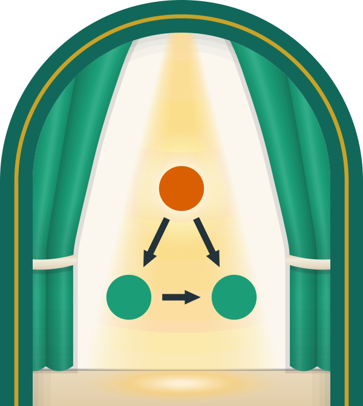
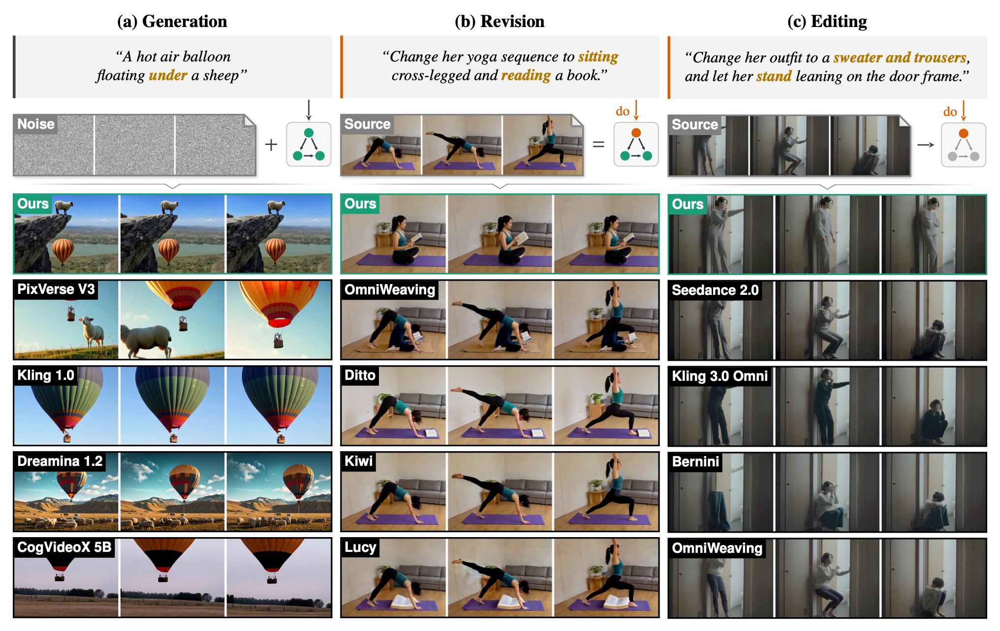

<p align="center">
  
</p>

<h1 align="center">Causal Dioramas: Controllable Video Generation,<br>Revision and Editing via Intervention</h1>

<p align="center">
  <a href="https://arxiv.org/pdf/2611.28098"><b>Paper</b></a> &nbsp;·&nbsp;
  <a href="https://arxiv.org/abs/2611.28098"></a> &nbsp;·&nbsp;
  <a href="https://sanshuiii.github.io/CausalDiorama/"><b>Project page</b></a> &nbsp;·&nbsp;
  <a href="code/README.md"><b>Code</b></a>
</p>

**TL;DR.** A Causal Diorama decomposes a video into a concept graph of variables that can be intervened on individually, so that one framework generates finely controllable videos from text, and revises generated videos and edits real videos by intervention, faithful to the instruction while preserving the unaffected content.

<p align="center">
  
</p>

<p align="center"><sub>
<b>Comparisons between the Causal Diorama and others on generation, revision and editing.</b>
Generation builds the Causal Diorama from the prompt and renders it under sampled noise (+), whereas revision and editing intervene on it with an instruction (do).
The Causal Diorama of its generated video is known exactly (=), while that of a real video has to be inferred (→).
Our method completes every task and preserves the unaffected content, while the other methods leave the task incomplete or introduce unintended changes.
</sub></p>

## Abstract

Two centuries ago, an early cinema-like theater called the Diorama could already control its scenes at will.
Today's video generation models produce videos of near-cinematic quality, yet they still lack this controllability.
This limitation stems from the inherent semantic gap between text and pixels, since a prompt can describe a video only coarsely and leaves its details and relations beyond control.
We bring this ability to video generation with Causal Dioramas, modules that decompose a video into a concept graph of variables that can be intervened on individually.
Each instruction is translated into an intervention on the concept graph, modifying the specified concepts and their dependents.
A connector then conveys this intervention to the video generator, which reuses the original noise to produce a counterfactual video while preserving all other content.
Building on Causal Dioramas, we develop a unified framework for controllable generation, counterfactual revision of generated videos and editing of real videos.
We outperform both open-source and commercial models in controllability on T2V-CompBench, CoVEBench and OpenVE-Bench.

## Code

[`code/`](code/) holds the code of the paper's three tasks, which share one representation, the Causal Diorama: a structured plan of the scene (camera, entities, state tracks, events, dependencies, timeline), executed by a deterministic white-model renderer, plus one reference picture per entity and one of the empty place.

| Task | Entry point | Input | Output | Paper results |
|---|---|---|---|---|
| Generation | `code/bin/cd_gen.py` | a prompt | a Causal Diorama and its video | T2V-CompBench |
| Revision | `code/bin/cd_revise.py` | a Causal Diorama, an edit instruction | the edited diorama and its video | CoVEBench revision |
| Editing | `code/bin/cd_edit.py` | a real video, an edit instruction | the fitted diorama, the edited diorama, the edited video | CoVEBench editing, OpenVE-Bench |

## Quick start

Full requirements, model list and options: [`code/README.md`](code/README.md).

**1. Download the code**

```bash
git clone https://github.com/sanshuiii/CausalDiorama.git
cd CausalDiorama/code
```

**2. Download the models**

Set the install locations (workstation, GPU nodes, shared directory) and let the script print the download commands for every model
(MiniMax H3 Ref2VA, CWM LoRA, Qwen-Image-2.1, Grounding DINO, SAM 2.1, Depth-Anything-V2; no weights are included):

```bash
cp config/site.example.json config/my_site.json        # edit the locations
python3 bin/configure.py --config config/my_site.json  # writes the configured copy
cd <configured copy>
python3 bin/cd_init.py --downloads                      # prints the download commands; run them
```

**3. Configure the API**

The agents use Claude through the Anthropic Messages API:

```bash
cp config/cd.env.example config/cd.env                 # set ANTHROPIC_API_KEY
source config/cd.env
python3 bin/cd_init.py --check                         # API, workstation modules, ffmpeg, runner
```

**4. Run**

```bash
# generation: a prompt -> a Causal Diorama and its video
python3 bin/cd_gen.py --prompt "A hot air balloon floating under a sheep" --run balloon --out out/balloon --agent api
# revision: intervene on the diorama
python3 bin/cd_revise.py --diorama out/balloon/diorama --instruction "Make the balloon blue and let it rise slowly" --run balloon_blue --out out/balloon_blue --agent api
# editing: a real video
python3 bin/cd_edit.py --video in.mp4 --instruction "Replace the background with a snowy forest" --run snow1 --out out/snow1 --agent api
```

`--agent claude-code` runs each agent task as a Claude Code process instead of the API.

## Citation

```bibtex
@misc{shen2026causaldioramascontrollablevideo,
      title={Causal Dioramas: Controllable Video Generation, Revision and Editing via Intervention},
      author={Yifan Shen and Xinyi Yang and Peiyuan Zhu and Yichang Jian and Jinyuan Hu and Xilin He and Fengming Zhu and Guangyi Chen and Kun Zhang},
      year={2026},
      eprint={2611.28098},
      archivePrefix={arXiv},
      primaryClass={cs.CV},
      url={https://arxiv.org/abs/2611.28098},
}
```
